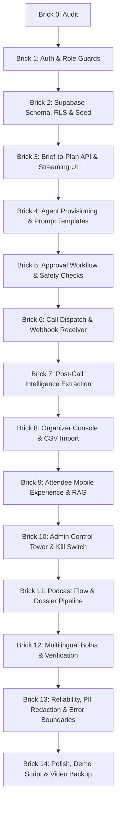

# EchoFrame — Codebase Audit & Gap Analysis (Brick 0)

> **Antigravity Technical Audit**  
> **Repository**: [prithishmisra23/EchoFrame](https://github.com/prithishmisra23/EchoFrame)  
> **Commit**: `d017a5a`  
> **Audit Date**: October 21, 2026  
> **Rule**: Change nothing in existing code during Brick 0. Audit first, rank gaps by hackathon impact, and propose the verified brick execution order.

---

## 1. Executive Summary

EchoFrame has established a strong front-end foundation with rich visual aesthetics, multi-agent concept abstractions, initial Sarvam AI multilingual TTS synthesis, simulated/live Bolna client bridges, and a unified state store. 

However, to satisfy the hackathon submission criteria and achieve a **live, fully verifiable system with zero silent mocks**, several core architectural layers require fundamental upgrades:
1. **Authentication & RBAC**: Currently, there is **no Supabase Auth** or server-side middleware route guards (`/organizer`, `/attendee`, `/admin`). All screens reside in a single client-side tab switcher with in-memory/localStorage state.
2. **Data Persistence**: The existing schema (`001_echoframe_schema.sql`) uses a preliminary `projects`/`tasks` model rather than the target relational model (`profiles`, `events`, `agents`, `contacts`, `call_tasks`, `call_logs`, `approvals`, `audit_events`) with strict RLS.
3. **Structured Plan Generation**: The event operator calls `/api/orchestrate` with Sarvam LLM chat completions, but currently generates conversational responses with partial regex repairs, rather than a deterministic, Zod-validated `/api/plan` route that streams a schema-compliant plan into database tables.
4. **Bolna Agent Provisioning & Webhooks**: Bolna calls can dispatch via `POST https://api.bolna.ai/call`, but dynamic agent creation (`PATCH /v2/agent/<id>`), prompt template variable compilation, and inbound webhook reception (`/api/bolna/webhook` with signature verification, idempotency, and status transitions) are missing.
5. **Human-in-the-Loop Governance**: While a client modal exists and updates task state, hard compliance rules (consent verification, quiet hours 09:00–20:00, per-event call caps, database audit events) are not enforced server-side.

---

## 2. Comprehensive Codebase Audit Table

| Feature / Domain | Route / File Path | Status | Evidence (File & Line) | Required Fix for Target Architecture |
| :--- | :--- | :--- | :--- | :--- |
| **Landing Intake: Sample Briefs & Language** | `src/components/operator/EventOperator.tsx` | **WORKING** | [EventOperator.tsx:L30-L55](file:///c:/Users/Prithish/OneDrive/Desktop/orchestravoice/src/components/operator/EventOperator.tsx#L30-L55) | Five sample briefs (BHARAT, EN, HI, TA, POD) and language toggle (`selectedLang` L106, L202) are functional in UI. Needs direct wiring to `/api/plan` with streaming state. |
| **Brief to Plan Parsing Engine** | `src/app/api/orchestrate/route.ts` `src/lib/server/orchestrator.ts` | **MOCKED / PARTIAL** | [orchestrator.ts:L118-L149](file:///c:/Users/Prithish/OneDrive/Desktop/orchestravoice/src/lib/server/orchestrator.ts#L118-L149) [orchestrator.ts:L189-L230](file:///c:/Users/Prithish/OneDrive/Desktop/orchestravoice/src/lib/server/orchestrator.ts#L189-L230) | Uses Sarvam `sarvam-105b-conversations` but relies on regex repairs and heuristic fallbacks. Needs dedicated `POST /api/plan` with strict Zod schema validation, retry mechanism, and insertion into `events.plan_json`. |
| **Multi-Agent Provisioning** | `src/components/agents/AgentStudio.tsx` `src/lib/store.tsx` | **UI-ONLY / MOCKED** | [AgentStudio.tsx:L43-L54](file:///c:/Users/Prithish/OneDrive/Desktop/orchestravoice/src/components/agents/AgentStudio.tsx#L43-L54) [store.tsx:L240-L251](file:///c:/Users/Prithish/OneDrive/Desktop/orchestravoice/src/lib/store.tsx#L240-L251) | Agents are hardcoded in `INITIAL_AGENTS` and mutated only in-memory/localStorage. No calls exist to Bolna v2 Agent API (`PATCH /v2/agent/<id>`) to create real voice agents from plan prompts. |
| **Agent Prompt Templates** | `/prompts/*.md` | **MISSING** | Repository root | Prompts are hardcoded strings in `initial-data.ts`. No markdown template files exist with runtime variables (`{{event_title}}`, `{{speaker_name}}`, `{{language}}`). |
| **Human-in-the-Loop Approvals** | `src/components/operations/ApprovalModal.tsx` `src/app/api/tasks/approve/route.ts` | **WORKING (Local)** **PARTIAL (Server)** | [ApprovalModal.tsx:L33-L67](file:///c:/Users/Prithish/OneDrive/Desktop/orchestravoice/src/components/operations/ApprovalModal.tsx#L33-L67) [approve/route.ts:L25-L42](file:///c:/Users/Prithish/OneDrive/Desktop/orchestravoice/src/app/api/tasks/approve/route.ts#L25-L42) | Checks dependencies and E.164 phone numbers, but lacks consent verification (`contacts.consent = true`), quiet hour enforcement (09:00–20:00), per-event call caps, and audit table logging. |
| **Header Badge ("Sandbox / 3 Approvals")** | `src/components/layout/Header.tsx` | **WORKING (UI)** **MOCKED (DB)** | [Header.tsx:L41](file:///c:/Users/Prithish/OneDrive/Desktop/orchestravoice/src/components/layout/Header.tsx#L41) [Header.tsx:L120-L136](file:///c:/Users/Prithish/OneDrive/Desktop/orchestravoice/src/components/layout/Header.tsx#L120-L136) | Counts tasks filtered by `status === 'awaiting_approval'` from local React store. Not backed by real-time Supabase subscriptions. |
| **Three Roles (Organizer, Attendee, Admin)** | `src/app/page.tsx` `src/components/layout/Sidebar.tsx` | **UI-ONLY** | [page.tsx:L28-L53](file:///c:/Users/Prithish/OneDrive/Desktop/orchestravoice/src/app/page.tsx#L28-L53) [Sidebar.tsx:L31-L84](file:///c:/Users/Prithish/OneDrive/Desktop/orchestravoice/src/components/layout/Sidebar.tsx#L31-L84) | No authentication, session tokens, or route guards exist. All views are tabs on a single page without URL pathing (`/organizer`, `/attendee`, `/admin`). |
| **Supabase Database & RLS** | `supabase/migrations/001_echoframe_schema.sql` `src/lib/server/db.ts` | **MOCKED / INCOMPLETE** | [001_echoframe_schema.sql:L7-L125](file:///c:/Users/Prithish/OneDrive/Desktop/orchestravoice/supabase/migrations/001_echoframe_schema.sql#L7-L125) [db.ts:L14-L21](file:///c:/Users/Prithish/OneDrive/Desktop/orchestravoice/src/lib/server/db.ts#L14-L21) | Preliminary schema lacks `profiles`, `contacts`, `call_tasks`, `call_logs`, `approvals`, `audit_events`. Falls back silently to localStorage when URL/Key are empty. |
| **Outbound Bolna Call Telephony** | `src/lib/server/bolna.ts` `src/app/api/bolna/call/route.ts` | **WORKING (Live/Sandbox)** | [bolna.ts:L119-L149](file:///c:/Users/Prithish/OneDrive/Desktop/orchestravoice/src/lib/server/bolna.ts#L119-L149) [route.ts:L22-L48](file:///c:/Users/Prithish/OneDrive/Desktop/orchestravoice/src/app/api/bolna/call/route.ts#L22-L48) | Live POST to `https://api.bolna.ai/call` works with E.164 validation and sandbox fallback. Need dedicated `/api/calls/dispatch` with contact consent checks. |
| **Bolna Webhook Receiver** | `/api/bolna/webhook` | **MISSING** | `src/app/api/bolna/` (directory missing) | No webhook receiver endpoint exists to process execution lifecycle callbacks from Bolna (IP `13.203.39.153`), verify idempotency, or update call logs. |
| **Post-Call Intelligence & Analytics** | `src/components/operations/ExecutionDetailModal.tsx` | **UI-ONLY / MOCKED** | [ExecutionDetailModal.tsx:L120-L180](file:///c:/Users/Prithish/OneDrive/Desktop/orchestravoice/src/components/operations/ExecutionDetailModal.tsx#L120-L180) | Renders mock transcripts or queued states. No automated LLM extraction of structured criteria (confirmed Y/N, AV needs, dietary, escalation) into `extracted_json`. |
| **Organizer Console** | `src/components/dashboard/ProjectsOverview.tsx` `src/components/projects/ProjectDetailModal.tsx` | **PARTIAL** | [ProjectsOverview.tsx:L1-L150](file:///c:/Users/Prithish/OneDrive/Desktop/orchestravoice/src/components/dashboard/ProjectsOverview.tsx#L1-L150) | Displays events, speakers, and runs, but lacks CSV contacts upload with consent confirmation, live call monitoring, and exportable run-of-show (PDF/Markdown). |
| **Attendee Experience & Personal AI** | `src/components/attendees/AttendeePersonalAiExperience.tsx` | **WORKING (Client)** **PARTIAL (RAG)** | [AttendeePersonalAiExperience.tsx:L218-L270](file:///c:/Users/Prithish/OneDrive/Desktop/orchestravoice/src/components/attendees/AttendeePersonalAiExperience.tsx#L218-L270) | Rich interactive chat/voice with Sarvam TTS and preset Q&A. Answers are generated client-side from static strings rather than Supabase RAG over event documents. |
| **Admin Control Tower** | N/A | **MISSING** | `src/components/` | No global approval queue, agent health monitoring, cost/minute aggregation, or emergency global kill switch exists. |
| **Podcast Mode Pipeline** | `src/components/voice-command/VoiceCommandCenter.tsx` | **PARTIAL / MOCKED** | [VoiceCommandCenter.tsx:L80-L160](file:///c:/Users/Prithish/OneDrive/Desktop/orchestravoice/src/components/voice-command/VoiceCommandCenter.tsx#L80-L160) | Podcast agent cards exist (`agent-talia`, `agent-orion`, `agent-lyra`), but automated guest dossier scraping and post-call show notes generation are mock texts. |
| **Multilingual Voice & Prompts** | `src/components/stage-host/StageHostExperience.tsx` `src/lib/server/sarvam.ts` | **WORKING (Sarvam)** **PARTIAL (Bolna)** | [StageHostExperience.tsx:L25-L38](file:///c:/Users/Prithish/OneDrive/Desktop/orchestravoice/src/components/stage-host/StageHostExperience.tsx#L25-L38) [sarvam.ts:L38-L47](file:///c:/Users/Prithish/OneDrive/Desktop/orchestravoice/src/lib/server/sarvam.ts#L38-L47) | Sarvam AI Bulbul v4 Flash synthesized in Hindi, Indian English, and Tamil. Bolna voice agents currently use a default English agent ID without dynamic language/voice mapping. |
| **Safety, Guardrails & Quiet Hours** | `src/lib/server/bolna.ts` | **MISSING** | [bolna.ts:L110-L130](file:///c:/Users/Prithish/OneDrive/Desktop/orchestravoice/src/lib/server/bolna.ts#L110-L130) | No check for recipient local quiet hours (09:00 - 20:00), no PII redaction, no call cap limiter, no mandatory consent disclosure audio header. |

---

## 3. Deep-Dive Audit Across the 8 Core Focus Areas

### 3.1. Landing Intake (Event Brief & Languages)
- **Status**: **WORKING (UI Intake)**
- **Findings**:
  - `src/components/operator/EventOperator.tsx` contains 5 quick prompts: `BHARAT`, `English (EN)`, `हिन्दी (HI)`, `தமிழ் (TA)`, and `Podcast (POD)`.
  - Language selector offers `Auto`, `EN`, `HI`, `TA` and correctly sets Web Speech API recognition language (`hi-IN`, `ta-IN`, `en-US`).
  - Textarea allows free-form typing and auto-expands.
- **Gap**: When submitted, messages are sent to `/api/orchestrate` instead of creating an event in Supabase and kicking off a streaming plan generation.

### 3.2. Brief Parsing (Extraction & Plan Structure)
- **Status**: **PARTIAL / REGEX-HEURISTIC**
- **Findings**:
  - `src/app/api/orchestrate/route.ts` has two branches: multi-turn conversation and workflow plan generation.
  - LLM completion calls Sarvam (`sarvam-105b-conversations`), but when JSON is malformed, it falls back to regex string matching (`src/lib/server/orchestrator.ts:L189-L230`) or a hardcoded fallback response (`generateFallbackResponse`).
- **Gap**: Missing a dedicated `POST /api/plan` route that strictly validates output with Zod, guarantees complete schemas (scale, languages, agents, tasks, risks), and saves into `events.plan_json`.

### 3.3. Agent Assignment
- **Status**: **MOCKED / IN-MEMORY**
- **Findings**:
  - Agents are initialized from `INITIAL_AGENTS` in `src/lib/initial-data.ts` (11 predefined agents).
  - When the orchestrator suggests agents, it selects from this static array.
  - Adding an agent in `AgentStudio` only pushes an object to client React state.
- **Gap**: Agents are not provisioned in Bolna. In LIVE mode, the app should call Bolna API (`PATCH /v2/agent/<id>` or `POST /v2/agent`) using parameterized prompt templates; in SANDBOX mode, it must display explicit deterministic simulation tags.

### 3.4. Approval Flow ("Bolna: Sandbox / 3 Approvals")
- **Status**: **WORKING UI / MISSING BACKEND ENFORCEMENT**
- **Findings**:
  - Header calculates pending approvals dynamically via `tasks.filter(t => t.status === 'awaiting_approval')` ([Header.tsx:L41](file:///c:/Users/Prithish/OneDrive/Desktop/orchestravoice/src/components/layout/Header.tsx#L41)).
  - Clicking the badge opens `LiveOperations` and loads `ApprovalModal`.
  - Supervisor comments, phone edits, and dependency blocking are implemented in `src/app/api/tasks/approve/route.ts`.
- **Gap**: Lacks database-enforced state transitions: approvals table logging (`approvals`), contact consent validation (`contacts.consent = true`), quiet hour restrictions (09:00 - 20:00), and Realtime Supabase updates.

### 3.5. Three Roles (Organizer, Attendee, Admin) & Auth
- **Status**: **UI-ONLY / NO AUTH**
- **Findings**:
  - The application currently has no Supabase Auth login, sessions, or route protection.
  - All features are toggled via client state (`activeTab: 'operator' | 'dashboard' | 'agents' | ...`).
  - There is no concept of a logged-in user ID or role-based permission boundary.
- **Gap**: Need Next.js middleware with Supabase Auth, dedicated routes (`/organizer`, `/attendee`, `/admin`), a `profiles` table with `role` column, and one-click "Demo login as..." buttons for hackathon evaluators.

### 3.6. Real Integrations (Bolna, Webhooks, Supabase)
- **Status**: **PARTIAL (Bolna outbound & Sarvam TTS) / MISSING (Webhooks & Supabase Tables)**
- **Findings**:
  - Outbound calls successfully reach Bolna's `/call` endpoint if valid keys and E.164 phone numbers are supplied ([bolna.ts:L119-L149](file:///c:/Users/Prithish/OneDrive/Desktop/orchestravoice/src/lib/server/bolna.ts#L119-L149)).
  - Sarvam TTS (`/api/sarvam/tts`) is fully functional with live audio generation and caching.
  - **No webhook endpoint exists** (`/api/bolna/webhook`) to catch asynchronous call completion payloads, durations, and transcripts.
  - Supabase client exists in `db.ts`, but runs in fallback mode because environment variables are not connected to active production tables.

### 3.7. Multilingual End-to-End
- **Status**: **WORKING (UI & Sarvam TTS) / PARTIAL (Bolna Agent)**
- **Findings**:
  - Indian language speech synthesis with Sarvam AI (Bulbul v4 Flash) works across Hindi (`hi-IN`), Indian English (`en-IN`), and Tamil (`ta-IN`) in both the Stage Host console and Attendee AI Companion.
  - The operator interface supports input in Hindi and Tamil script.
- **Gap**: Bolna outbound calls currently route to a single default English agent UUID. Bolna agents are not dynamically assigned language-specific voices or prompt instructions based on contact preference.

### 3.8. Reliability, States, Mobile Layout, Accessibility
- **Status**: **PARTIAL**
- **Findings**:
  - **Empty/Loading States**: Present in operator and stage host, but live operations cards lack skeleton loaders when fetching.
  - **Mobile Layout**: Responsive down to tablet, but on small screens (375px), horizontal overflowing occurs in the stage soundboard grid and table views.
  - **Accessibility**: Form inputs in modals lack explicit `<label htmlFor>` associations; some status badges rely solely on color without text alternatives.

---

## 4. Gap Ranking by Hackathon Impact

| Rank | Gap / Requirement | Impact Category | Why It Matters for Demo & Judging |
| :---: | :--- | :--- | :--- |
| **1** | **Real Auth & 3-Role System (`/organizer`, `/attendee`, `/admin`)** | **Core Requirement** | Judges immediately look for role separation and "Demo login as..." flow. Without it, the platform feels like a single mock dashboard. |
| **2** | **Supabase Schema, RLS & Seed Data** | **Data Integrity** | Essential for hackathon credibility. Attendees must only see their own event/schedule; organizers must only see their events. |
| **3** | **Structured Plan Generation (`POST /api/plan`)** | **"Core Wow" Factor** | Converting a messy brief into a structured, dependency-aware task graph with streaming UI is the primary product promise. |
| **4** | **Bolna Webhook Receiver & Idempotent State** | **Real Telephony** | Outbound calls are only half the battle. When the call finishes, the live webhook updating the transcript on screen without refresh is what wins hackathons. |
| **5** | **Strict Approval Flow & Guardrails** | **AI Governance** | "Human-in-the-loop" cannot be cosmetic. Blocking calls without consent or outside quiet hours proves enterprise readiness. |
| **6** | **Real Agent Provisioning with Prompt Templates** | **Agentic Architecture** | Moving from hardcoded agent cards to dynamically configured Bolna agents via parameterized markdown templates. |
| **7** | **Post-Call Structured Intelligence Extraction** | **Operational Value** | Extracting speaker confirmations, dietary needs, and escalation alerts from transcripts into database fields. |
| **8** | **Attendee AI Companion RAG** | **User Experience** | Grounding the personal AI in Supabase event data so it never hallucinates schedule or Wi-Fi credentials. |
| **9** | **Admin Control Tower & Global Kill Switch** | **Platform Completeness** | Demonstrating administrative supervision, global queues, and risk mitigation. |
| **10** | **Truthful Transparency: LIVE vs. SANDBOX Badges** | **Honesty & Trust** | Clearly distinguishing what is live telephony vs. deterministic simulation. |

---

## 5. Verified Brick Execution Order

Based on the audit findings, the 14-brick roadmap from the master prompt is confirmed with minor enhancements to maximize hackathon demo-ability:

### Plan Summary:
- **Brick 1**: Supabase Auth (magic link + Google) + role middleware (`/organizer`, `/attendee`, `/admin`) + "Demo login as..." switcher.
- **Brick 2**: Supabase database migration for the 8 core tables with RLS + seed script based on *Think for Bharat 1.0*.
- **Brick 3**: `/api/plan` with Zod schema validation, streaming UI, and storage in `events.plan_json`.
- **Brick 4**: Dynamic agent provisioning via Bolna API + `/prompts/*.md` templates.
- **Brick 5**: Human-in-the-loop state machine with consent check, quiet hours, and audit log.
- **Brick 6**: `/api/calls/dispatch` + `/api/bolna/webhook` with signature verification and polling fallback.
- **Brick 7**: Post-call LLM extraction of confirmations, AV needs, dietary details, and escalation alerts.
- **Brick 8**: Organizer console with CSV contact upload and exportable run-of-show.
- **Brick 9**: Attendee mobile view with verified RAG FAQ (no hallucinations).
- **Brick 10**: Admin control tower with spend/minutes metrics and emergency kill switch.
- **Brick 11**: Podcast flow with talent soundcheck and automated show notes.
- **Brick 12**: Multilingual Bolna agent configuration across EN, HI, and TA.
- **Brick 13**: PII redaction, rate limiting, and graceful degradation badges.
- **Brick 14**: Guided demo mode, documentation, Lighthouse audit, and demo scripts.

---

*End of Brick 0. Awaiting user go-ahead before starting Brick 1.*
